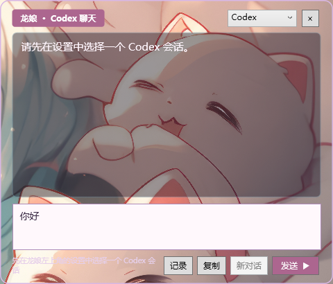
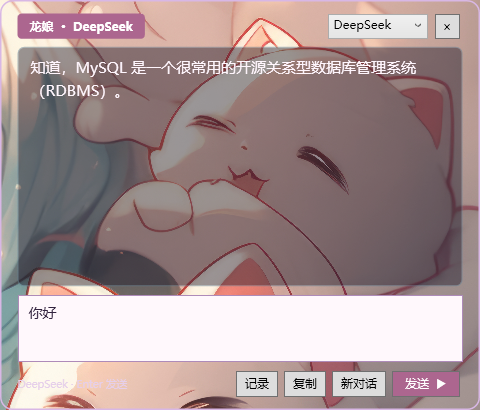

# GPT-niang-Chat

GPT-niang-Chat 是基于 [T7moris/GPT-Niang](https://github.com/T7moris/GPT-Niang) 的 Windows 定制版本：保留 Codex 额度挂件，增加 Codex 会话聊天、DeepSeek API 聊天、对话记录和可调整的对话框背景。它是第三方项目，并非 OpenAI 或 DeepSeek 官方产品。

## 界面预览

| Codex 会话 | DeepSeek 对话 |
| --- | --- |
|  |  |

截图使用半透明对话框，背后的画面来自拍摄时的桌面背景，仅用于展示透明效果；背景画面不包含在项目的可用素材中，相关权利归原权利人所有。

## 项目来源与修改说明

本项目在 **[GPT-Niang](https://github.com/T7moris/GPT-Niang)** 的基础上进行修改。上游仓库由 **T7moris** 发起维护，原项目代码版权归其作者及 GPT-Niang 贡献者所有；上游版权与 MIT 许可证全文保留在本项目的 [LICENSE](LICENSE) 中。

GPT-niang-Chat 是独立的非官方定制版，基于本地 GPT-Niang 1.3.4 安装副本扩展；当前未确认该副本对应的上游 Git 提交号。主要修改包括 Codex 桌面会话聊天桥接、DeepSeek API 聊天、对话框样式与可折叠记录，以及为保护这些修改而禁用界面内上游更新。上述修改不代表上游作者认可或维护本项目。

其他素材和引用来源见 [第三方来源与许可](THIRD_PARTY_NOTICES.md)。

## 使用前请了解

- 代码采用 MIT 许可；龙娘图片及其派生图标**不适用 MIT**，仅允许随本项目及其非商业副本展示和分发，并须保留素材声明。其他用途及第三方参考角色的权利见 [图片素材声明](gpt-niang-usage/assets/CHARACTER-NOTICE.txt)。语录来源与许可见 [语录许可](gpt-niang-usage/assets/quotes-LICENSE.txt)。
- 该版本仍需在全新 Windows 环境进行端到端安装验证。其 Codex 聊天桥接依赖桌面客户端可用的本地工具接口，兼容性可能随客户端改变；它不连接普通 ChatGPT 会话。
- DeepSeek 使用你自己的 API 密钥，发送消息会产生服务商费用。模型可用性与服务商接口可能变化。
- 原上游更新器仍指向上游正式版，更新可能覆盖本定制版。本定制版在界面中禁用了上游自动和手动更新入口，并保留旧更新清理功能；不要直接运行上游更新脚本，除非接受覆盖本地修改。

## 环境与安装

需要 Windows、Node.js 20 或更新版本，以及已安装并登录的 Codex 桌面客户端。完整解压或克隆后，将整个项目放在长期保留的位置，运行 `gpt-niang-usage/安装GPT娘.cmd`。安装程序会注册本地插件及当前用户的启动任务。已有 GPT 娘安装可能导致安装程序因身份冲突而停止；先备份数据并检查现有安装，勿强行覆盖。

如需先检查依赖，可在 PowerShell 运行：

```powershell
powershell.exe -NoProfile -ExecutionPolicy Bypass -File .\gpt-niang-usage\Install.ps1 -CheckOnly
```

该检查会尝试创建并删除临时写入探针，不注册插件。实际安装会为本机生成 `installation.json` 并重写 `.mcp.json` 的本地路径；**不要提交这些安装后产生的个人配置**，提交前请检查差异。停用可运行 `gpt-niang-usage/停用GPT娘.cmd`，个人数据会保留。

## 聊天

在挂件设置的“聊天设置”里选择 Codex 会话，或在聊天窗口切换到 DeepSeek 并保存 API 密钥。密钥行保存后收起，可从聊天设置重新打开。背景、查看记录和全部展开／折叠也在聊天设置中。“记录”按问答显示本扩展保存的记录；历史中不包含启用该功能前的对话。DeepSeek 的发送上下文仅在本次运行中保留，重启后不会自动恢复。Codex 需要桥接连接和已有本地 Codex 会话。

## 数据与隐私

- DeepSeek 密钥和本扩展的问答记录在 `%USERPROFILE%\AppData\Local\GPTNiangUsage` 下使用当前 Windows 用户账户的保护机制加密保存；同一账户下运行的程序仍可能访问这些数据。
- Codex 聊天桥接在程序目录的 `local-codex-chat-state/` 中保存状态、回复和待发送信息，其中可能包含**未加密的对话正文**。不要将该目录或日志、备份、截图提交到公开仓库。
- 发送 DeepSeek 消息时，本次对话上下文会发送给 DeepSeek。请自行判断是否包含敏感信息。

## 开发与测试

在 `gpt-niang-usage/` 目录运行 `node --test tests/*.test.mjs`；Windows 图形及安装相关测试可运行 `powershell.exe -NoProfile -STA -ExecutionPolicy Bypass -File tests/run-windows-tests.ps1`。这些测试包含隔离模拟，不等同于全新电脑上的完整安装和联网验证。

## 许可与致谢

保留根目录及子目录的 MIT 许可和作者声明；图片素材及上游语录分别受各自声明约束。感谢 GPT-Niang 上游作者与贡献者。

为兼容现有安装与 Codex 插件注册，本版本内部目录和插件标识仍使用 `gpt-niang-usage`；项目展示名称为 GPT-niang-Chat。

公开发布前请阅读 [安全与公开发布检查](SECURITY.md)，并运行 `python tools/check-public-release.py`。
